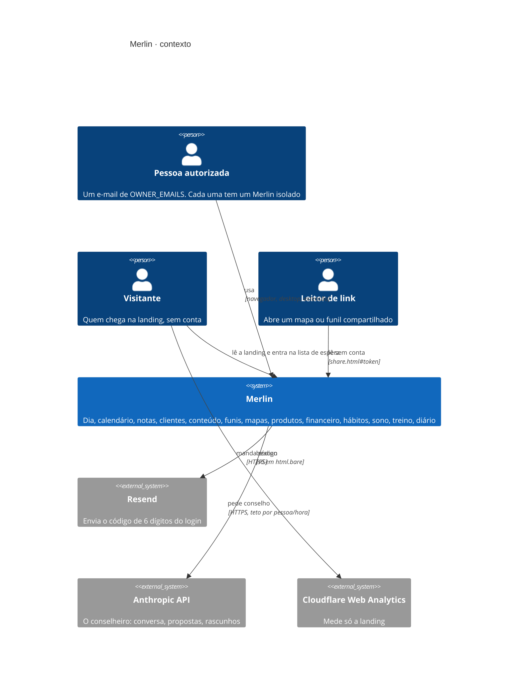
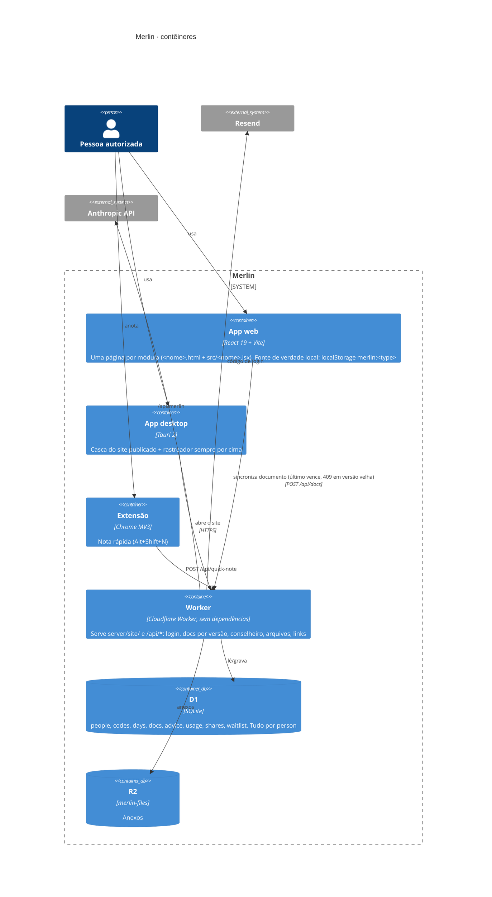
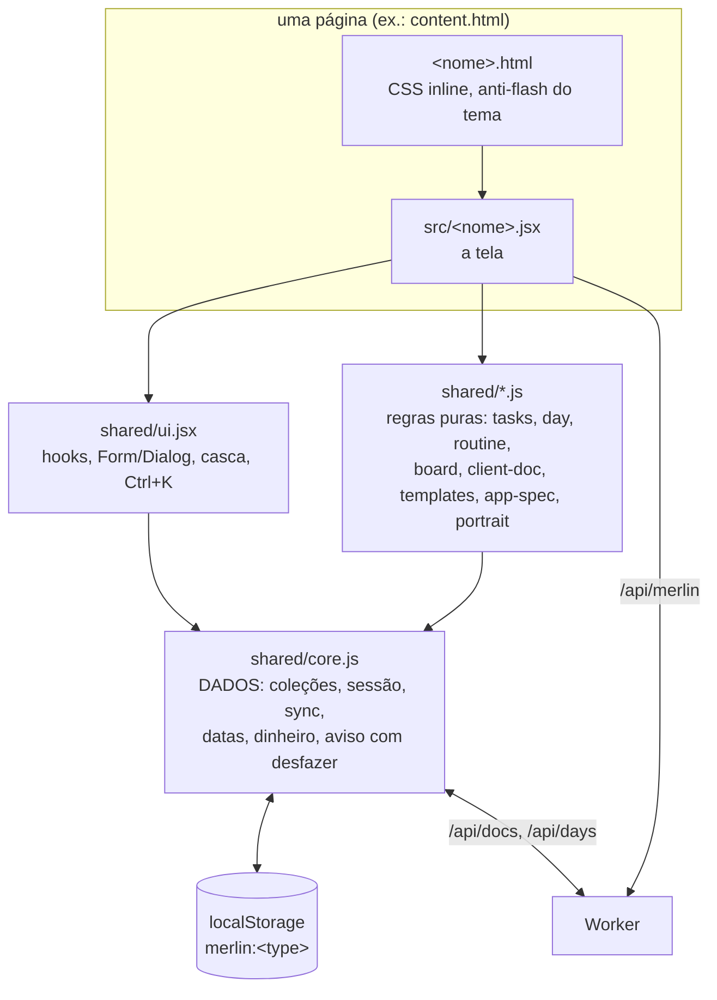

# Merlin · arquitetura em C4

Três níveis de zoom, do mundo para dentro. Servem para entender como as partes se relacionam
sem ler código, que muda rápido. **Quem muda uma fronteira daqui atualiza o diagrama no mesmo
PR** (`docs/workflow.md`). O detalhe de cada peça está em [PROJETO.md](../../PROJETO.md).

Levantado do código em 17/10/2026.

## 1. Contexto: quem usa e com quem o Merlin fala

## 2. Contêineres: o que roda onde

## 3. Componentes do app web

Regras que os diagramas pressupõem: a tela nunca toca o `localStorage` direto (só pelo
`core.js`); a lógica pura vive em `shared/*.js` e é testada sem navegador; e o servidor não
entende o conteúdo dos documentos, só guarda cada um com a versão e diz qual é a mais nova.
Por isso o resumo das áreas que vai junto de cada pergunta ao Merlin (o retrato,
`shared/portrait.js`) é montado na tela, das coleções locais, e viaja no pedido a
`/api/merlin`: o Worker o repassa à Anthropic sem ler documento nenhum.
